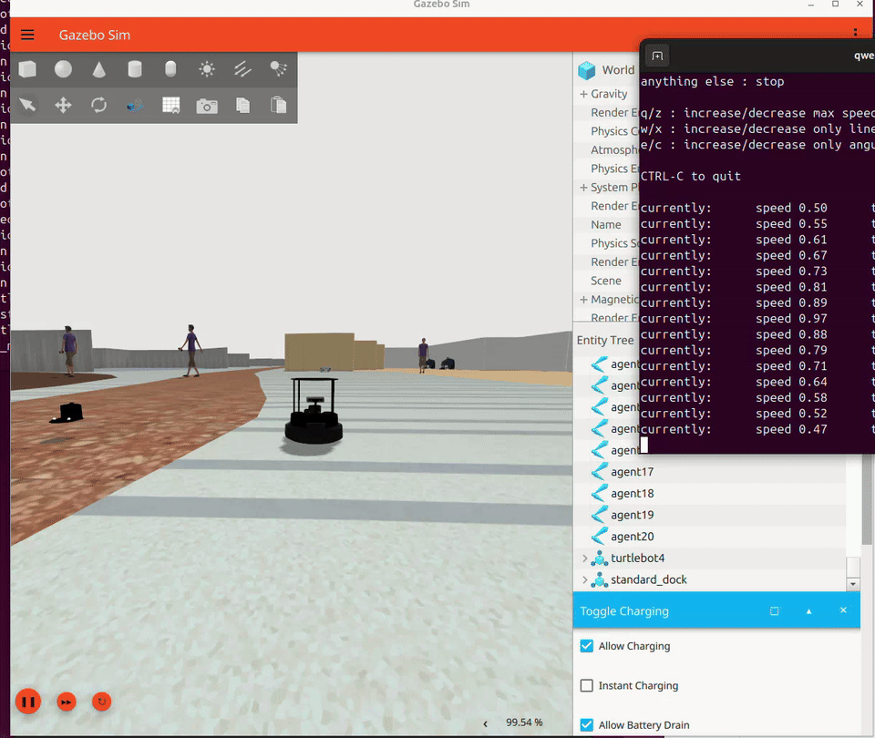

# SICNav Social Navigation in RMF Airport

<p align="center">
  
</p>
<p align="center">
  <b>Open-RMF Airport · Crowd Simulation · TurtleBot4 · Gazebo Harmonic</b><br>
  Social Navigation Environment for SICNav-Diffusion Integration
</p>

---

## 📑 Overview

Open-RMF의 **Airport Terminal** 환경에 moving crowd와 **TurtleBot4**를 통합한 social navigation simulation 환경.

ROS 2 Jazzy와 Gazebo Harmonic을 기반으로 공항 내부의 보행자 환경을 구성하고, TurtleBot4를 spawn하여 ROS2 control 기반 주행까지 검증.

최종 목표는 Gazebo에서 제공하는 보행자 상태를 기반으로 **JMID trajectory prediction + SICNav controller**를 연결하여 다중 보행자 환경에서 closed-loop social navigation을 구현하는 것.

```text
RMF Airport Terminal
        ↓
Crowd Simulation
        ↓
Human Agents
        +
TurtleBot4
        ↓
Human / Robot State
        ↓
JMID Trajectory Prediction
        ↓
SICNav Controller
        ↓
[v, ω]
        ↓
TurtleBot4
```

현재 단계에서는 **Airport + Crowd + TurtleBot4 simulation environment 구축 및 robot control validation** 완료.

---

## 🎯 Project Goal

다중 보행자가 이동하는 공항 환경에서 TurtleBot4 기반 social navigation pipeline 구축.

최종 구조:

```text
Moving Pedestrians
        ↓
Human State Estimation
        ↓
Trajectory History
        ↓
JMID
        ↓
Joint Human Future Prediction
        ↓
SICNav
        ↓
ORCA / KKT / MPC
        ↓
Velocity Command
        ↓
TurtleBot4
```

초기 단계에서는 Gazebo Ground Truth를 사용하고, 이후 RGB-D 기반 human tracking으로 확장 예정.

---

## 🧩 System Architecture

```text
┌──────────────────────────────────────┐
│           Open-RMF Airport           │
│                                      │
│   Crowd Agents        TurtleBot4     │
│       │                   │          │
└───────┼───────────────────┼──────────┘
        │                   │
        │                   ↓
        │              Robot State
        │
        ↓
 Human State
        │
        └─────────┬─────────┘
                  ↓
          Trajectory Buffer
                  ↓
               JMID
                  ↓
      Human Future Trajectories
                  ↓
              SICNav
                  ↓
          ORCA + KKT + MPC
                  ↓
              [v, ω]
                  ↓
       /cmd_vel_unstamped
                  ↓
        diffdrive_controller
                  ↓
             TurtleBot4
```

---

## 🛠 Environment

| Component | Configuration |
|---|---|
| OS | Ubuntu 24.04 |
| ROS | ROS 2 Jazzy |
| Simulator | Gazebo Harmonic |
| Environment | Open-RMF Airport Terminal |
| Crowd Simulation | RMF Crowd Simulation |
| Robot | TurtleBot4 Standard |
| Robot Control | ros2_control |
| Drive Controller | diffdrive_controller |
| ROS-Gazebo Interface | ros_gz_bridge |

---

## 🏢 RMF Airport Environment

Open-RMF demo의 Airport Terminal world 사용.

Crowd simulation 활성화:

```bash
source /opt/ros/jazzy/setup.bash
source ~/rmf_ws/install/setup.bash

ros2 launch rmf_demos_gz \
airport_terminal.launch.xml \
use_crowdsim:=1
```

Airport 내부에 다수의 moving pedestrian agent 생성.

```text
agent1
agent2
agent3
...
agent20
```

Crowd simulator가 각 pedestrian agent를 인식한 뒤 simulation 진행.

```text
Crowd Simulator found agent: agent16
Crowd Simulator found agent: agent17
Crowd Simulator found agent: agent18
...
Gazebo Models are all loaded!
Start simulating...
```

---

## 🚶 Crowd Simulation

RMF Crowd Simulation을 이용해 공항 내부에 이동 보행자 생성.

현재 단계에서는 Gazebo가 알고 있는 agent pose를 직접 활용하는 **Ground Truth 기반 human state pipeline**을 우선 사용.

```text
Gazebo Crowd Agent
        ↓
Agent ID
        ↓
World Pose
        ↓
x, y
        ↓
Temporal Difference
        ↓
vx, vy
        ↓
Human State
```

예정된 JMID 입력 형태:

```text
Human 1
[x, y, vx, vy]

Human 2
[x, y, vx, vy]

Human 3
[x, y, vx, vy]
```

Agent ID가 simulation 내부에서 이미 유지되기 때문에 초기 GT 기반 실험에서는 별도 tracking 불필요.

---

## 🤖 TurtleBot4 Integration

Robot:

```text
TurtleBot4 Standard
```

Airport world 내부 spawn position:

```text
x   = 136.5
y   = -41.7
z   = 0.1
yaw = 0.0
```

Spawn:

```bash
ros2 launch turtlebot4_gz_bringup \
turtlebot4_spawn.launch.py \
model:=standard \
x:=136.5 \
y:=-41.7 \
z:=0.1 \
yaw:=0.0 \
rviz:=false \
nav2:=false \
slam:=false \
localization:=false
```

Gazebo model 확인:

```bash
gz model --list | grep -Ei "turtlebot|dock"
```

확인된 entity:

```text
turtlebot4
standard_dock
```

Robot pose 확인:

```bash
gz model -m turtlebot4 --pose
```

확인된 pose:

```text
x = 136.522
y = -41.700
z ≈ 0.0
```

---

## ⚙️ ROS2 Control

TurtleBot4는 `ros2_control` 기반으로 구동.

기본 구조:

```text
/cmd_vel_unstamped
        ↓
motion_control
        ↓
diffdrive_controller
        ↓
ros2_control
        ↓
Wheel Joints
        ↓
TurtleBot4
```

Controller manager 확인:

```bash
ros2 service list | grep controller_manager
```

주요 service:

```text
/controller_manager/list_controllers
/controller_manager/load_controller
/controller_manager/configure_controller
/controller_manager/switch_controller
```

---

## 🔧 Controller Recovery

RMF Airport + TurtleBot4 통합 과정에서 automatic `diffdrive_controller` spawner가 lock 상태로 멈추는 문제 발생.

Lock file:

```text
~/.ros/locks/ros2-control-controller-spawner.lock
```

Stuck spawner 제거 후 controller manager service를 이용해 직접 controller 초기화.

### Load

```bash
ros2 service call \
/controller_manager/load_controller \
controller_manager_msgs/srv/LoadController \
"{name: 'diffdrive_controller'}"
```

### Configure

```bash
ros2 service call \
/controller_manager/configure_controller \
controller_manager_msgs/srv/ConfigureController \
"{name: 'diffdrive_controller'}"
```

### Activate

```bash
ros2 service call \
/controller_manager/switch_controller \
controller_manager_msgs/srv/SwitchController \
"{activate_controllers: ['diffdrive_controller'],
  deactivate_controllers: [],
  strictness: 2,
  activate_asap: true,
  timeout: {sec: 5, nanosec: 0}}"
```

Controller 활성화 이후 TurtleBot4 motion 정상 확인.

---

## ⏱ Gazebo Clock Bridge

RMF simulation의 ROS `/clock` 연결 문제를 해결하기 위해 별도 Gazebo-ROS clock bridge 사용.

```bash
ros2 run ros_gz_bridge parameter_bridge \
'/clock@rosgraph_msgs/msg/Clock[gz.msgs.Clock' \
--ros-args \
-r __node:=manual_clock_bridge
```

구조:

```text
Gazebo Simulation Clock
        ↓
ros_gz_bridge
        ↓
/clock
        ↓
ROS2 Simulation Time
```

---

## 📦 Gazebo Resource Path

RMF launch 환경에서 Gazebo resource path가 덮어써지면서 TurtleBot4 visual resource가 정상적으로 로드되지 않는 문제 발생.

필요한 ROS resource path:

```text
/opt/ros/jazzy/share
```

Gazebo system plugin 로딩을 위한 library path:

```text
/opt/ros/jazzy/lib
```

최종적으로 다음 두 환경 경로가 중요.

```text
GZ_SIM_RESOURCE_PATH
GZ_SIM_SYSTEM_PLUGIN_PATH
```

역할:

```text
GZ_SIM_RESOURCE_PATH
        ↓
Robot / Mesh / Model Resources

GZ_SIM_SYSTEM_PLUGIN_PATH
        ↓
Gazebo ROS Plugins
        ↓
gz_ros2_control
```

---

## 🎮 Teleoperation

TurtleBot4 manual control 검증:

```bash
ros2 run teleop_twist_keyboard \
teleop_twist_keyboard \
--ros-args \
--remap cmd_vel:=/cmd_vel_unstamped
```

입력된 velocity command가 motion control과 diffdrive controller를 통해 robot wheel command로 전달되는 것 확인.

```text
Keyboard
   ↓
cmd_vel
   ↓
/cmd_vel_unstamped
   ↓
motion_control
   ↓
diffdrive_controller
   ↓
TurtleBot4
```

---

## 🚀 Integrated Bringup

Airport, Crowd, TurtleBot4, clock bridge, controller bootstrap을 하나의 ROS2 package에서 관리.

```text
sicnav_airport_bringup/
│
├── CMakeLists.txt
├── package.xml
│
├── launch/
│   └── airport_tb4.launch.py
│
└── scripts/
    └── controller_bootstrap.sh
```

목표 실행 방식:

```bash
ros2 launch \
sicnav_airport_bringup \
airport_tb4.launch.py
```

`controller_bootstrap.sh` 역할:

```text
Wait for controller_manager
        ↓
Detect diffdrive_controller
        ↓
Remove stuck spawner
        ↓
Load Controller
        ↓
Configure Controller
        ↓
Activate Controller
        ↓
TurtleBot4 Ready
```

---

## 📁 Project Structure

```text
sicnav-rmf-airport/
│
├── README.md
├── CMakeLists.txt
├── package.xml
│
├── launch/
│   ├── airport_cropped_tb4.launch.py   # Cropped Concourse + TurtleBot4
│   └── airport_tb4.launch.py           # Multi-mode Bringup (Cropped / Full)
│
├── worlds/
│   └── airport_cropped.sdf             # Cropped Airport Gazebo Harmonic World
│
├── models/
│   ├── airport_cropped/                # Cropped Terminal Wall SDF
│   ├── PotatoChipChair/                # Airport Concourse Furniture
│   ├── WhiteChipChair/
│   ├── Standing person/                # Static Pedestrian
│   └── MaleVisitorPhone/               # Animated Pedestrian Actor
│
└── scripts/
    └── controller_bootstrap.sh         # diffdrive_controller auto-activation
```

---

## 🚀 Quick Start

### 1. ROS2 & RMF Source

```bash
source /opt/ros/jazzy/setup.bash
source ~/rmf_ws/install/setup.bash
```

### 2. Build

```bash
cd ~/social_nav_ws

colcon build \
--symlink-install \
--packages-select sicnav_airport_bringup
```

### 3. Source Workspace

```bash
source ~/social_nav_ws/install/setup.bash
```

### 4. Launch Simulation

#### A. 잘라낸 공항(Cropped Concourse) 실행 (기본 권장)
```bash
ros2 launch sicnav_airport_bringup airport_cropped_tb4.launch.py
```
또는
```bash
ros2 launch sicnav_airport_bringup airport_tb4.launch.py
```
> 기본 spawn 위치: `x=0.0, y=0.0, z=0.1, yaw=0.0` (중앙 통로)

#### B. 기존 전체 RMF Airport 실행 시
```bash
ros2 launch sicnav_airport_bringup airport_tb4.launch.py use_cropped:=false x:=136.5 y:=-41.7
```

---

## 🔄 Current Pipeline

현재 구현 범위:

```text
RMF Airport
    ↓
Crowd Simulation
    ↓
TurtleBot4 Spawn
    ↓
ROS2 Control
    ↓
diffdrive_controller
    ↓
Teleoperation
```

다음 integration 단계:

```text
Crowd Agent GT Pose
        ↓
Human Trajectory Buffer
        ↓
JMID
        ↓
Joint Future Prediction
        ↓
SICNav
        ↓
TurtleBot4
```

---

## 🧠 JMID Integration

JMID는 pedestrian history를 이용해 다중 보행자의 future trajectory를 joint하게 prediction.

예정 pipeline:

```text
Human History
        ↓
Trajectron++ Context Encoder
        ↓
JMID Diffusion Model
        ↓
Multiple Joint Future Samples
        ↓
Human Intended Motion
```

초기 입력은 Gazebo Ground Truth 사용.

이후 RGB-D perception pipeline으로 교체 예정.

---

## 🧭 SICNav Integration

JMID prediction을 SICNav controller와 연결.

예정 구조:

```text
JMID Prediction
        ↓
Human Preferred Velocity
        ↓
ORCA
        ↓
KKT Reformulation
        ↓
Bilevel MPC
        ↓
Acados
        ↓
[v, ω]
        ↓
TurtleBot4
```

---

## 📷 Human Perception & Tracking

GT 기반 navigation validation 이후 실제 perception pipeline 추가 예정.

```text
RGB-D Camera
        ↓
Person Detection
        ↓
Multi-Object Tracking
        ↓
Depth
        ↓
Camera XYZ
        ↓
TF
        ↓
Map-frame XYZ
        ↓
Velocity Estimation
        ↓
ID, x, y, vx, vy
        ↓
JMID
```

Detection 결과를 frame 간 association하여 persistent human ID와 trajectory history 생성.

---

## 📊 Planned Evaluation

Navigation 성능:

```text
Success Rate
Collision Rate
Minimum Human Distance
Time to Goal
Path Length
```

Prediction 성능:

```text
ADE
FDE
```

System 성능:

```text
JMID Inference Time
MPC Solve Time
Control Frequency
GPU Memory Usage
```

추가 검증:

```text
Gazebo GT Human State
vs
RGB-D Tracking Human State
```

---

## 🎯 Future Work

- Gazebo crowd Ground Truth extraction
- Human trajectory buffer
- JMID ROS2 integration
- SICNav controller integration
- Closed-loop TurtleBot4 navigation
- Nav2 global path integration
- RGB-D human detection
- Multi-object tracking
- Map-frame human state estimation
- GT vs perception comparison
- Crowd density experiments
- Social navigation performance evaluation

---

## 🚀 Execution Guide (Ubuntu 단일 머신)

기본 실행은 Ubuntu에서 Gazebo, ROS2, JMID, ORCA, MPC를 모두 처리합니다.
ROS 노드가 제어기를 직접 호출하므로 Mac 서버 실행이나 TCP 연결이 필요하지 않습니다.
JMID는 비동기 2Hz, ORCA+MPC 계산 및 명령 출력은 10Hz입니다.

```text
Ubuntu: Gazebo/odom → ROS node → JMID worker (2Hz)
                           └→ latest prediction → ORCA + MPC → /cmd_vel (10Hz)
```

Ubuntu 24.04 / ROS2 Jazzy의 시스템 Python 3.12를 사용하는 별도
`~/social_nav_ws/.venv` 환경을 구성합니다. `sicnav/requirements-ubuntu.txt`가
Ubuntu용 목록입니다. 기존 Python 3.8용 `requirements.txt`를 설치하지 마세요.

ROS2/Gazebo/RMF, gcc/g++, make, cmake, curl, colcon이 준비된 Ubuntu에서:

```bash
cd ~/social_nav_ws/src/sicnav-rmf-airport-main
./scripts/setup_ubuntu.sh
./scripts/run_ubuntu.sh
```

`setup_ubuntu.sh`는 시스템 Python 기반 venv를 만들고 Python 패키지를 설치하며,
복제본의 Acados/RVO2 및 Tera renderer를 Ubuntu 아키텍처에 맞게 빌드합니다.
Mac용 `.dylib`와 renderer를 재사용하지 않습니다. Rust가 없으면 공식 rustup으로
사용자 Rust 환경을 설치합니다. 모든 ROS 패키지가 같은 Python ABI를 사용합니다.

`run_ubuntu.sh`는 ROS underlay(`~/sicnav_airport_ws/install/setup.bash`가 있으면 포함),
현재 workspace overlay, Acados 라이브러리 경로, Python 실행 경로를 설정합니다.
화면 없는 검증은 `./scripts/run_ubuntu.sh headless:=true`로 실행합니다.

CPU VM 실행 프로필에서는 JMID 후보 **25개를 생성해 상위 15개**를 MPC에 전달합니다.
기존 모델 기본값은 후보 100개이며, 후보 수 감소는 예측 다양성에 영향을 줄 수 있습니다.
기존 수로 비교하려면 `SICNAV_JMID_SAMPLES=100 ./scripts/run_ubuntu.sh`를 사용하세요.

보행자 입력은 `sicnav_crowd_msgs`가 설치된 경우 `/crowd_sim/states`의 Menge 위치·속도를
우선 사용합니다. 없는 환경에서는 Gazebo pose 토픽을 사용합니다. Actor mesh pose가
게시되지 않는 Gazebo 환경에서는 CrowdState publisher가 필요합니다.

MPC는 외부 시뮬레이션 시계에 연결될 때 기존 실시간 반복 횟수 설정을 사용합니다.
오프라인 solver cache와 실시간 solver cache를 분리합니다. 첫 실행에서는 생성된
MPC C 코드를 컴파일하므로 시작에 수 분 걸릴 수 있습니다.

원격 실행은 호환 옵션으로만 남겨 두었습니다. 명시적으로 `transport:=tcp`를
선택해야 서버 연결을 사용합니다. 기본값은 `transport:=local`입니다.

---

## 📌 Status

```text
RMF Airport Environment        ✅
Crowd Simulation               ✅
TurtleBot4 Spawn               ✅
Gazebo / ROS Clock Bridge      ✅
ROS2 Control                   ✅
diffdrive_controller           ✅
TurtleBot4 Teleoperation       ✅
Integrated Bringup             ✅
Crowd GT State Extraction      ✅
JMID Integration               ✅
SICNav Integration             ✅
Closed-loop Social Navigation  ✅

Nav2 Integration               ⏳
RGB-D Human Tracking           ⏳
```

---

## 📚 Related Projects

- Open-RMF
- Gazebo Harmonic
- TurtleBot4
- ROS 2 Jazzy
- SICNav-Diffusion
- JMID
- Trajectron++
- ORCA
- Acados

## 비동기 JMID / 10 Hz 제어

`--control_hz 10.0`이 기본값이며 JMID는 `policy.config`의
`async_jmid = true`, `jmid_hz = 2.0`을 사용합니다. 상태 입력은 기본 10Hz입니다.
ORCA+MPC는 입력 시뮬레이션 시각 기준 0.1초 간격으로 계산하고 새 명령을 발행합니다.
중복 시각에는 계산을 반복하지 않습니다. 제어 주기와 모델의 기존 0.25초
이산화 간격은 구분하며, warm start의 전진 시간도 실제 제어 주기를 따릅니다.

`use_sim_time=true`로 `/clock`을 사용합니다. 로봇의 `/odom.header.stamp`와
보행자 관측 시각을 `/clock` 기준 제어 시각으로 속도 보정해 맞추고, JMID 결과도 관측 기준 시각과 현재 시각의
차이를 반영하여 MPC 격자에 정렬합니다. 시뮬레이션 시간 역행 시 이력과 캐시를
초기화하고 이전 작업 결과는 폐기합니다.

JMID는 0.5초 간격으로 예약하며 실행 중에는 최신 예약만 유지합니다.
초기 추론 전에는 등속도 예측을 사용하고, 예측 범위를 넘으면 마지막 속도로
외삽합니다. 추론이 0.5초를 초과하거나 제어 계산이 0.1초를 초과하면 실제 주기는
느려질 수 있으므로 실기 성능 측정이 필요합니다.

검증: `python3 -m unittest discover -s tests -v`.
Ubuntu ARM64/Gazebo/모델/Acados 연결 및 주기는 검증했습니다. 다만 MPC 수렴 실패와
대체 명령 사용이 빈번하므로 안정 주행 검증 완료 상태는 아닙니다.


## 출력 명령의 속도·가속도 제한

`SICNavController.step()`에서 정상 최적화 결과와 기존 대체 명령에 동일한
`command_limits.py` 제한을 적용합니다. `policy.config`의 최대 전진/후진 속도,
회전속도, 가속도·감속도를 읽어 사용합니다. 회전 가속도는 Gazebo DiffDrive와
같은 3rad/s²입니다. 방향 전환은 먼저 정지한 뒤 반대 방향으로 가속합니다.

가속도 기준은 현재 odom의 로봇 진행 방향 속도입니다. 시간 간격은 실제
시뮬레이션 간격을 사용하되 최대 한 제어 주기로 제한해, 계산이 지연됐다고
다음 명령이 크게 뛰지 않도록 합니다. 클리핑 시 이전 MPC 궤적 캐시는 폐기합니다.
응답의 `raw_action`은 제한 전 명령, `action`은 적용 명령,
`command_limited`는 제한 여부입니다. TCP robot 입력의 선택적 `omega`는 rad/s입니다.

이 기능은 출력 명령의 물리 제한을 위한 것입니다. 기존 최적화 제약과 성공 판정은
유지하므로 MPC 수렴 실패 자체나 충돌 회피를 보장하지 않습니다.
