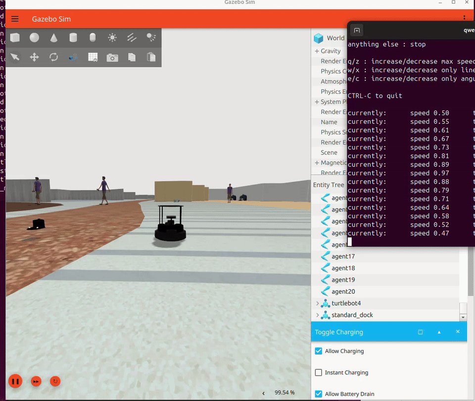
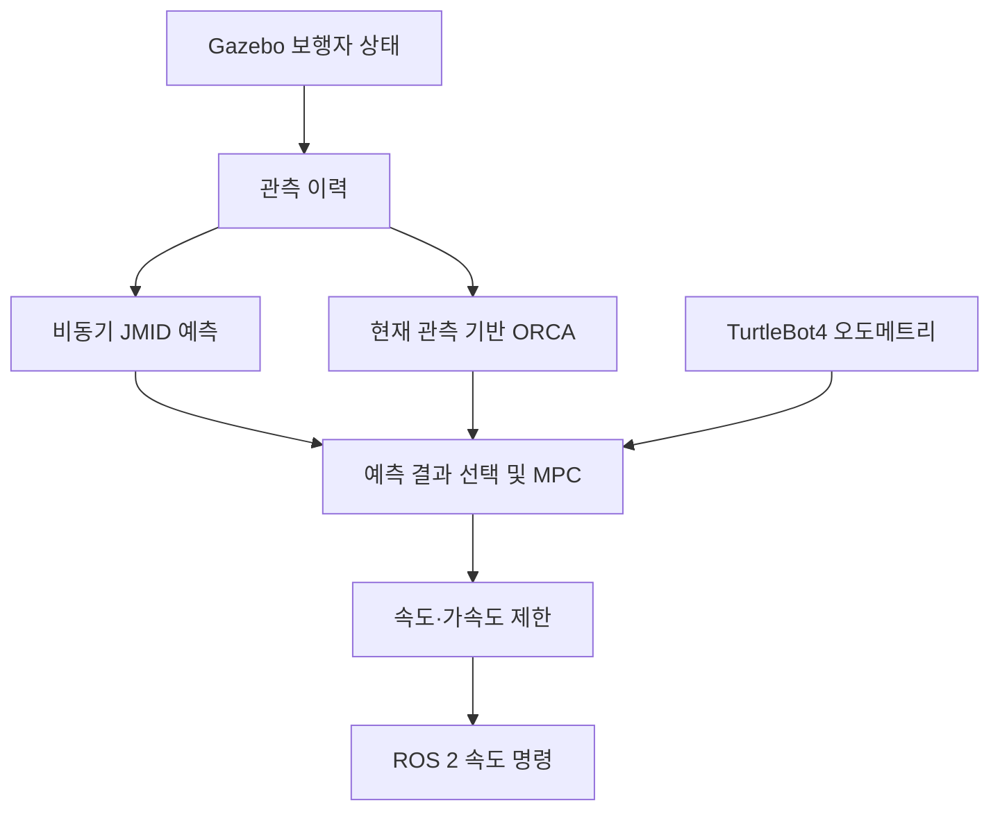

# SICNav in an Open-RMF Airport

ROS 2 Jazzy와 Gazebo Harmonic에서 **TurtleBot4가 움직이는 보행자 사이를 주행하는 시뮬레이션**입니다. Open-RMF 공항 시나리오에 JMID 보행자 궤적 예측과 SICNav의 ORCA·MPC 제어를 통합해 Ubuntu 한 대에서 실행합니다.



## 구현한 내용

- **시뮬레이션 통합** — Open-RMF 공항 터미널 일부를 재구성하고, Menge 보행자와 TurtleBot4를 배치했습니다. Gazebo의 시계와 오도메트리, 속도 명령을 ROS 2로 연결했습니다.
- **비동기 예측 및 제어** — JMID를 제어 루프와 별도로 실행합니다. H4 실험에서는 150 ms 소프트 데드라인 내에 새 JMID 결과를 받지 못하면 현재 관측을 사용하는 ORCA 기반 MPC로 전환하고, 늦게 도착한 결과는 폐기합니다.
- **CPU 실행 프로필** — 기본 실행 스크립트는 JMID 후보 생성 수를 25개로 설정합니다. 원래 후보 수인 100개로도 실행할 수 있습니다.
- **속도·가속도 제한** — 최적화 결과와 대체 명령에 TurtleBot4의 속도·가속도 제한을 적용합니다.



## 실험 결과와 검증 범위

[H4 실험 기록](experiments/)에는 Gazebo 90초 주행의 타이밍 자료가 포함되어 있습니다. [H4 변경 내역](https://github.com/h5JOON2/sicnav-rmf-airport-ubuntu/commit/b2ffe4c1de7af69a1d556760143ed37619f1f1ed)에는 단위 테스트 68개 통과가 기록되어 있습니다.

기존 Ubuntu ARM64 검증에서 Gazebo, JMID, Acados를 연결한 폐루프 제어가 동작했습니다. 기존 실행 기록에는 MPC 수렴 실패와 대체 명령 사용도 보고되어 있습니다. 주행 성공률과 충돌률은 반복 실험으로 추가 검증이 필요합니다.

기본 Gazebo 데모는 시뮬레이터의 보행자 상태를 사용합니다. `sicnav_crowd_msgs`가 있으면 `/crowd_sim/states`를 우선 사용하고, 그 외에는 Gazebo pose를 사용합니다. Gazebo가 보행자 pose를 게시하지 않는 환경에서는 CrowdState publisher가 필요합니다.

## Ubuntu에서 실행

Ubuntu 24.04, ROS 2 Jazzy, Gazebo Harmonic, 시스템 Python 3.12가 필요합니다. Open-RMF Gazebo 데모와 군중 시뮬레이션 플러그인, TurtleBot4 Gazebo 패키지를 먼저 준비하세요. 빌드에는 `git`, `curl`, `gcc`, `g++`, `make`, `cmake`, `colcon`, Python `venv`가 필요합니다.

```bash
mkdir -p ~/social_nav_ws/src
cd ~/social_nav_ws/src
git clone https://github.com/h5JOON2/sicnav-rmf-airport-ubuntu.git
cd sicnav-rmf-airport-ubuntu

bash scripts/setup_ubuntu.sh
bash scripts/run_ubuntu.sh
```

[설치 스크립트](scripts/setup_ubuntu.sh)는 Python 가상환경을 만들고 Ubuntu용 의존성, acados, RVO2를 설치한 뒤 ROS 패키지를 빌드합니다. Cargo가 없으면 rustup을 설치합니다. 첫 주행에서는 MPC 코드 생성과 컴파일로 시작까지 수 분 걸릴 수 있습니다.

두 스크립트는 `~/sicnav_airport_ws/install/setup.bash`가 있으면 자동으로 읽습니다. RMF를 다른 워크스페이스에 설치했다면 각 터미널에서 해당 설치 환경을 먼저 불러오세요.

```bash
# Gazebo GUI 없이 실행
bash scripts/run_ubuntu.sh headless:=true

# JMID 후보 100개로 실행
SICNAV_JMID_SAMPLES=100 bash scripts/run_ubuntu.sh
```

## 코드 읽기

| 위치 | 역할 |
| --- | --- |
| [launch/airport_cropped_tb4.launch.py](launch/airport_cropped_tb4.launch.py) | Gazebo 월드, ROS 브리지, 주행 노드 실행 |
| [scripts/sicnav_gazebo_client.py](scripts/sicnav_gazebo_client.py) | 관측 수집, 제어기 호출, 속도 명령 발행 |
| [sicnav/](sicnav/) | JMID 추론, ORCA 및 MPC 제어 로직 |
| [worlds/](worlds/), [maps/](maps/), [models/](models/) | 공항 월드, 보행자 맵, 시뮬레이션 모델 |
| [tests/](tests/) | 단위 테스트 |

```bash
python3 -m unittest discover -s tests -v
```

## 기반 프로젝트와 라이선스

[Open-RMF Demos](https://github.com/open-rmf/rmf_demos), [TurtleBot4 Simulator](https://github.com/turtlebot/turtlebot4_simulator), [Safe Interactive Crowd Navigation](https://github.com/sepsamavi/safe-interactive-crowdnav), [acados](https://github.com/acados/acados)를 사용합니다. 포함된 코드의 라이선스는 [SICNav MIT](sicnav/LICENSE)와 [Python-RVO2 Apache-2.0](Python-RVO2/LICENSE)을 확인할 수 있습니다.

기존 수동 구동 및 컨트롤러 복구 절차는 [이전 통합 기록](https://github.com/h5JOON2/sicnav-rmf-airport-ubuntu/blob/c9ab587d52aa1ac6c2cec67973ed3f7e879bbb84/README.md)에 있습니다.
